# Fjaum

**A monster-collecting RPG made with VM8.** You leave home in the village of
Tessel with one Fjaum from the elder, fill a party of three in the tall grass
of Mossway, Mosswood and the Ridgeway, beat the trainers on the way and the
Moss Keeper in the shrine's hall, and save your journey on the cart. Every
rule of the game (battles, catching, levels, moves, the party, the shop,
saving) is VM8 event-script data compiled to bytecode; the native side is
the engine's fixed VM8 runtime.

This is **Chapter 1** (the first zone). The game builds for five consoles
from the same project: Game Boy, Game Boy Color, Master System, Game Gear and
PC Engine.

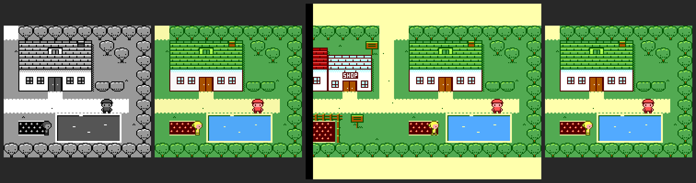

*Tessel on the Game Boy, Game Boy Color, Master System and Game Gear. The
Master System's bigger screen shows more of the town.*

## Screenshots (Game Boy Color)

| | | |
|:-:|:-:|:-:|
| 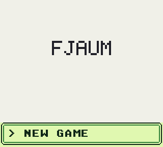 | 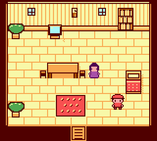 | 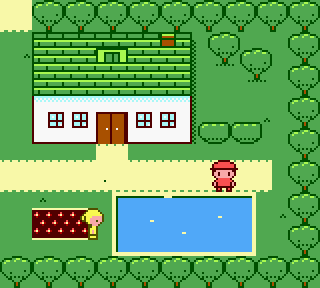 |
| The title | Home | Tessel |
| 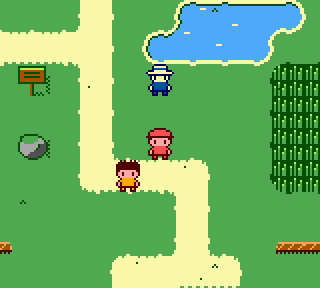 | 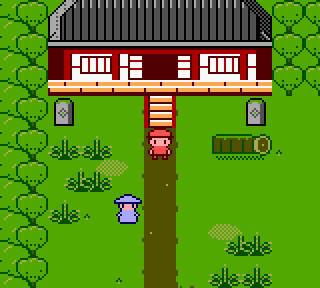 | 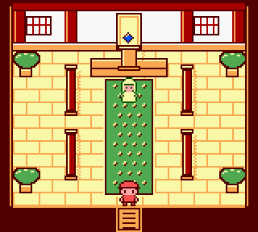 |
| Mossway, the route | Mosswood and its shrine | The shrine's hall |
| 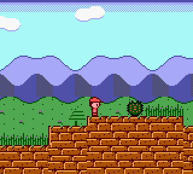 | 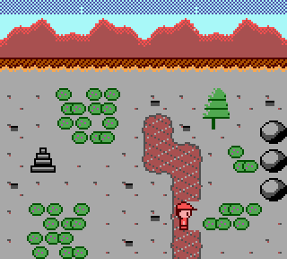 | 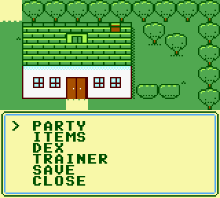 |
| The Ridgeway (side view, the thorn bush) | The Ridgeway top | The pause menu |
| 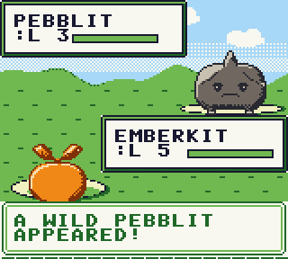 | 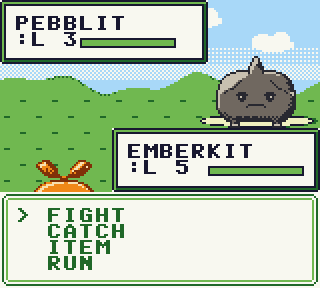 | 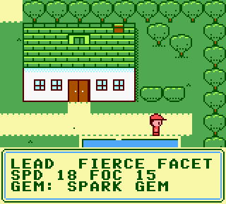 |
| A wild Fjaum appears | The battle menu | The lead's party card |

Every picture is a frame of the real ROM, taken headless (PyBoy for the Game
Boy family, libretro for the Master System and Game Gear) and scaled 2x.

## Build and play

From the `mosaik8/` root:

```
python mosaik8.py build --platform gameboy_color projects/vm-fjaum
```

`--platform` takes `gameboy`, `gameboy_color`, `sms`, `gamegear` or `pce`; the
ROM lands in `projects/vm-fjaum/build/<platform>/`. Any emulator for the
console plays it.

Controls: the d-pad walks, **A** talks, confirms and (on the Ridgeway) jumps,
**B** cancels a menu, **START** opens the pause menu. The [player manual](docs/manual.md)
has the rest.

Notes per console:

- **Game Boy / Game Boy Color:** music and a battery save.
- **Master System / Game Gear:** music and a cart-RAM save.
- **PC Engine:** plays without music and cannot save (SAVE says so).
- On the two bigger screens (Master System, PC Engine) a room smaller than
  the screen is centred (letterbox).

## Check it

```
python projects/vm-fjaum/verify.py          # the ROM checks (GB and SMS by default)
python tests/fjaum_chapter1_test.py         # the Chapter 1 rules on the reference interpreter
```

`verify.py` builds the ROMs and drives them headless through whole power
cycles: saving and continuing, the doors between the rooms, the people, a
battle and the thorn bush on the Ridgeway. The `tests/fjaum_*.py` modules run
the scripts on the reference interpreter (`mosaik_vm.refvm`) and check the
battle, the data tables and every Chapter 1 system.

## Inside

[docs/architecture.md](docs/architecture.md) explains how the game is put
together: the rooms, the scripts, the data tables, the save layout and the
budget. In short:

| | |
|---|---|
| `scripts/*.evt.toml` | the game's logic as VM8 event scripts (field and battle) |
| `scripts/tables.toml` | species, moves, learnsets, trainers, wild encounters, shops, gems, facets |
| `scripts/dialogue.toml` | every text and the name lists (species, moves, gems, facets) |
| `scripts/heap.toml` | the pinned variable layout, so a save survives an update |
| `world.toml` | the 11 rooms, their doors, triggers, people and palettes |
| `assets/` | tilesets, sprites, the font |
| `src/` | the boot shell and the generated modules |

The room art and the world layout are produced by generator scripts in the
MosaiK8 Studio repository; their output is checked in here, so the project
builds with the engine alone.
